<!--
SPDX-FileCopyrightText: 2026 shadPS4 Emulator Project
SPDX-License-Identifier: GPL-2.0-or-later
-->

<h1 align="center">
  <br>
  <b>brunoShadPs4</b>
  <br>
</h1>

<h1 align="center">
 <a href="https://github.com/serbru20066666/brunoShadPs4/stargazers">
        
 </a>
</h1>

# Información General

**brunoShadPs4** es un fork del emulador original [shadPS4](https://github.com/shadps4-emu/shadPS4), un emulador temprano de **PlayStation 4** para **Windows**, **Linux** y **macOS** escrito en C++.

Este fork está centrado en integrar mejoras gráficas, correcciones y ajustes específicos para juegos.

### Cambios integrados en este repositorio:
* **God of War III Remastered (Fix)**: Corrección de errores gráficos (líneas/rayas horizontales al renderizar) desactivando de manera forzada el MSAA del host específicamente para este título (CUSA01623 y CUSA01715).
* Ajustes de compilación mejorados y personalizados para SDL sin dependencias rotas de ramas anteriores.

* Antes:
*  

* Despues:
* 


<!-- juegos:inicio -->
### Juegos probados

Probados en Windows con un i7-14700KF y una Radeon RX 6800 XT.

#### God of War III Remastered

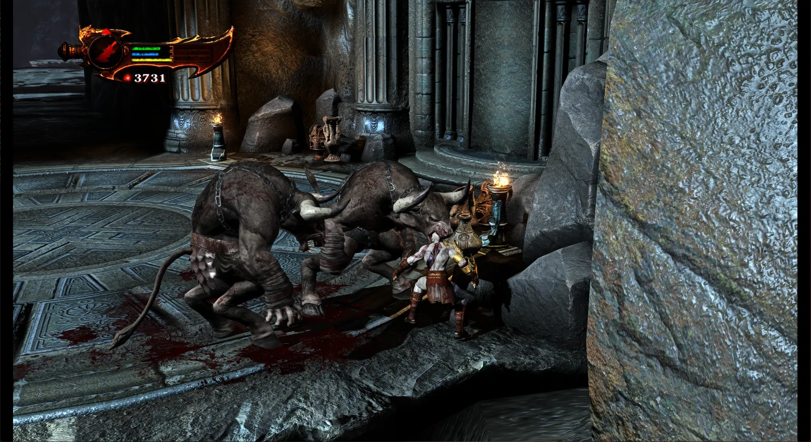

* Sin las rayas horizontales que aparecían en sombras, luces y partículas en tarjetas AMD.
* A 1440p con el parche de resolución, FXAA y FSR, con generación de cuadros opcional.
* La captura está tomada con **Realzar la calidad del juego** (Ajustes → Gráficos).
* Los shaders guardados cargan en menos de 6 s al iniciar (antes, cerca de un minuto).

#### inFamous Second Son

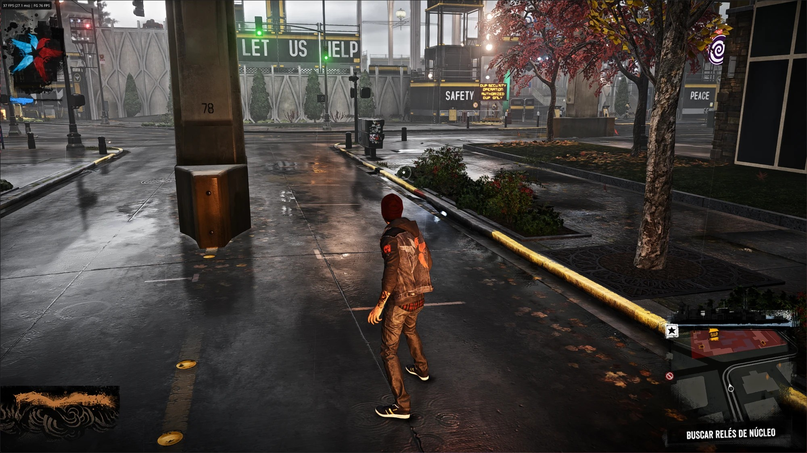

* Luz correcta, y efectos de humo y de poderes que antes no se dibujaban, con las lecturas precisas de la GPU.
* Esas lecturas hacían ir el juego a 12–20 fps; servidas desde una copia en memoria del equipo va a 30–44 fps según la zona.
* Generación de cuadros (FSR 3): en la captura, 37 fps del juego mostrados como 76.

#### The Order: 1886

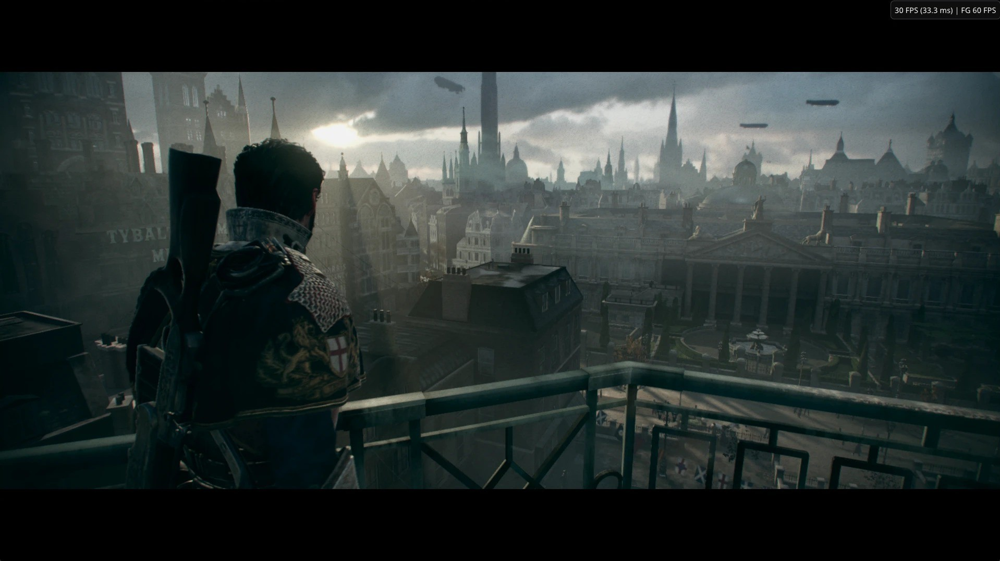

* Jugable desde la versión 0.24.0: entra a la partida y se mantiene en 30 fps, la velocidad original del juego.
* Los objetos (puertas, tuberías, floreros) ya no aparecen y desaparecen en cada cuadro en tarjetas AMD.
* Sin los tirones al moverse: la primera escena pasó de 18 a 30 fps, y el peor cuadro de 733 ms a 34 ms.
* Necesita los ajustes recomendados del lanzador; sin las lecturas de la GPU se queda en negro tras el menú.
<!-- juegos:fin -->

### Un motor para cada juego (desde la 0.28.0)

Algunos juegos funcionan mejor en un port o un fork hecho solo para ellos. brunoShadPs4 los abre por ti: tú eliges el juego (en el lanzador o desde un frontend como RetroBat) y el emulador lo pasa al programa que mejor lo ejecuta. Los demás juegos siguen en el motor de brunoShadPs4.

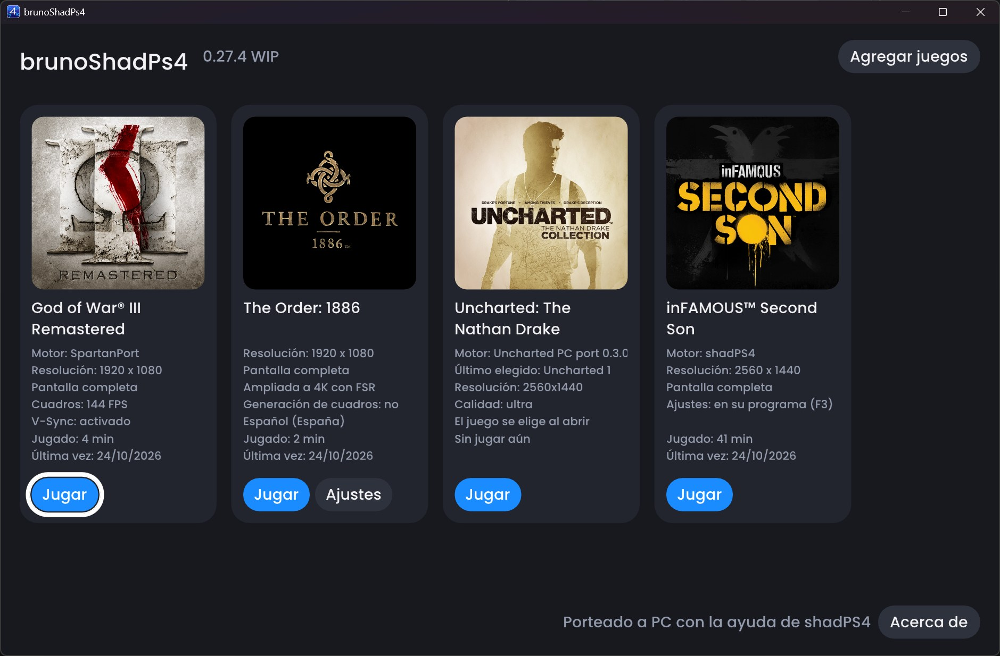

| Juego | Motor | Proyecto |
|---|---|---|
| God of War III Remastered | SpartanPort | [FelipePrado0/SpartanPort](https://github.com/FelipePrado0/SpartanPort) |
| inFAMOUS Second Son | build de shadPS4 para inFAMOUS | [axylpup/shadPS4](https://github.com/axylpup/shadPS4) |
| Uncharted: The Nathan Drake Collection | Uncharted PC port | [bc160201983/Uncharted-The-Nathan-Drake-Collection-PC-port](https://github.com/bc160201983/Uncharted-The-Nathan-Drake-Collection-PC-port) |
| Bloodborne | bloodborne_pc | [Supermedo/bloodborne_pc](https://github.com/Supermedo/bloodborne_pc) |
| The Order: 1886 y el resto | brunoShadPs4 | este repositorio |

Todos son de código abierto (GPL-2.0) y el mérito de cada uno es de sus autores. No vienen incluidos: descárgalos de sus páginas y descomprímelos en una carpeta `motores` junto a `shadPS4.exe`:

```
shadPS4.exe
motores.ini            (opcional: cambia o añade motores)
motores\SpartanPort\SpartanPort.exe
motores\inFamous\shadPS4.exe
motores\Uncharted\Uncharted Launcher.exe
motores\Bloodborne\Bloodborne.exe
```

* **Elección con el mando antes de jugar**: una pantalla para elegir la resolución (1080p, 1440p o 4K) con la cruceta, X para jugar y O para volver; en Uncharted, primero el juego de la colección. El resto de ajustes se ponen en lo que da más calidad y fps a cada port: pantalla completa, la mayor velocidad estable y el idioma en español.
* **En el lanzador**, cada tarjeta muestra el motor asociado, su versión instalada y un botón **Actualizar** para descargar e instalar automáticamente los últimos releases oficiales directamente desde GitHub respetando tus partidas y configuraciones. Los Ajustes del lanzador siguen disponibles para los juegos del motor propio.
* **Con RetroBat** (u otro frontend): basta con poner este `shadPS4.exe` como emulador de PS4. El programa espera a que termines de jugar, así que Select + Start cierra el juego entero, port incluido.
* **inFAMOUS Second Son**: de unos 32 fps con el motor anterior a unos 85 fps con el de axylpup, en la misma partida y el mismo sitio.

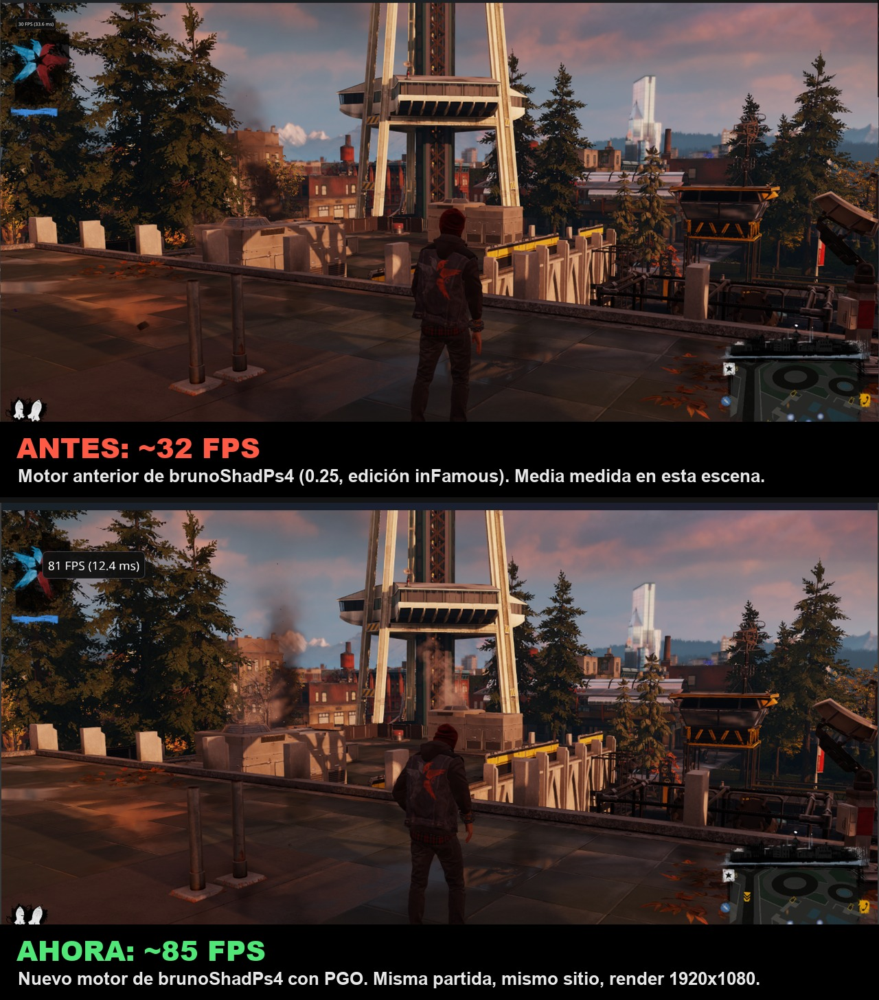

`motores.ini` permite cambiar el programa de cada juego, una línea por juego: `CUSA01623,CUSA01715 = spartanport | motores\SpartanPort\SpartanPort.exe`. Tipos: `spartanport`, `bloodborne`, `uncharted`, `shadps4-release`, `shadps4` (`--game`) e `interno` (el motor propio). Junto a cada programa, un `brunoshadps4.env` con líneas `NOMBRE=valor` le pasa variables de entorno.

### Cómo usarlo

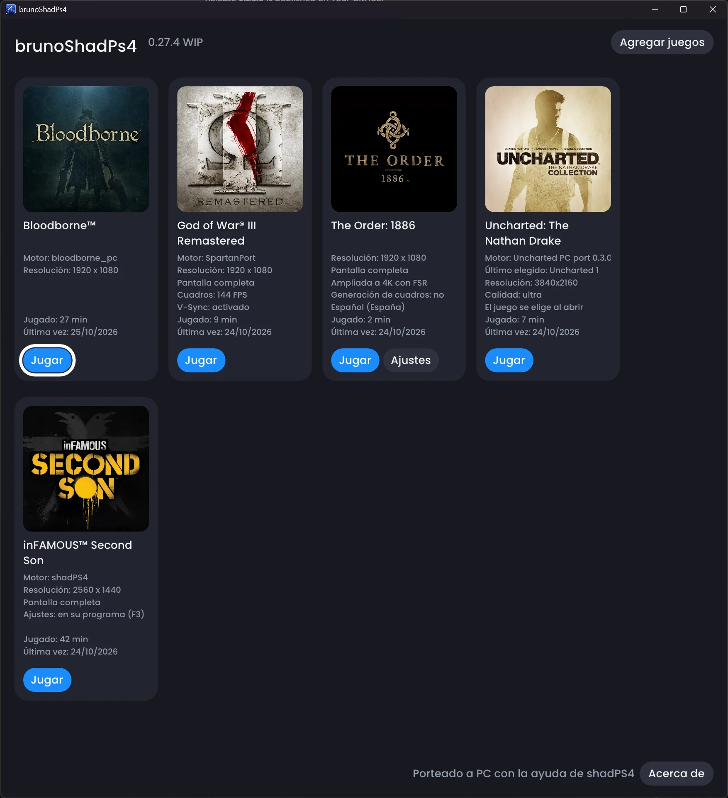

1. **Descarga** el `.zip` de Windows de esta versión en [Releases](https://github.com/serbru20066666/brunoShadPs4/releases) y descomprímelo en una carpeta, por ejemplo `C:\brunoShadPs4`.
2. **Descarga los motores** de los juegos que vayas a jugar (los enlaces están en la tabla de arriba) y descomprime cada uno en su carpeta dentro de `motores`, con el nombre exacto:
   ```
   C:\brunoShadPs4\shadPS4.exe
   C:\brunoShadPs4\motores\SpartanPort\SpartanPort.exe
   C:\brunoShadPs4\motores\inFamous\shadPS4.exe
   C:\brunoShadPs4\motores\Uncharted\Uncharted Launcher.exe
   C:\brunoShadPs4\motores\Bloodborne\Bloodborne.exe
   ```
   Los motores que no necesites se pueden omitir.
3. **Abre `shadPS4.exe`**, pulsa **Agregar juegos** y elige la carpeta donde guardas tus juegos de PS4. Cada juego es una carpeta con `eboot.bin` y `sce_sys`, igual que en shadPS4. Aparecen como tarjetas, y las que tienen motor dicen "Motor: …".
4. **Pulsa Jugar** (con el ratón o con X en el mando). Si el juego va con un motor, sale la pantalla de resolución: cruceta para elegir, X para jugar y O para volver al lanzador. En Uncharted primero eliges el juego de la colección.

Versiones de juego probadas: God of War III Remastered (CUSA01623), inFAMOUS Second Son 01.07 (la que da 4K nativo), Uncharted con la actualización 1.02 y Bloodborne 1.09.

### Cómo asociar un juego a su motor

- **Automático**: los juegos de la tabla se asocian solos por su número de serie (el `CUSA…` de PS4), en todas las regiones conocidas. Basta con que el motor esté en su carpeta. Si una tarjeta no dice "Motor: …", falta esa carpeta o el `.exe` tiene otro nombre.
- **A mano**: crea un archivo `motores.ini` junto a `shadPS4.exe` (en Releases hay uno de ejemplo, `motores.ini`) con una línea por juego:
  ```
  # serie(s) del juego = tipo | programa (ruta relativa a shadPS4.exe o absoluta)
  CUSA01623,CUSA01715 = spartanport | motores\SpartanPort\SpartanPort.exe
  CUSA00900 = bloodborne | D:\Juegos\bloodborne_pc\Bloodborne.exe
  CUSA00004 = interno
  ```
  El tipo dice cómo se le pasa el juego al programa: `spartanport`, `bloodborne`, `uncharted`, `shadps4-release` (un build de shadPS4 que lee `shadps4-game.txt`), `shadps4` (cualquier shadPS4 que acepte `--game`) o `interno`, que deja el juego en el motor de brunoShadPs4. Una línea de `motores.ini` manda sobre la asociación automática.
- La serie del juego está en su `sce_sys\param.sfo` y suele venir en el nombre de la carpeta o en las listas de juegos de PS4.

### Con RetroBat

1. En `RetroBat\emulators\shadps4\`, guarda una copia del `shadPS4.exe` que haya y pon en su lugar el de esta versión. Copia al lado la carpeta `motores` (y `motores.ini` si lo usas).
2. Deja tus juegos en `RetroBat\roms\ps4` como siempre. RetroBat los abre con shadPS4, y brunoShadPs4 los pasa a su motor con la pantalla de resolución, que se maneja con el mando.
3. **Select + Start** cierra el juego entero, port incluido, y vuelves a RetroBat.
4. Cada port guarda sus partidas en `motores\<motor>\user\savedata`, aparte de las de shadPS4. Para seguir una partida de shadPS4 en un port hay que copiarla allí (el formato de carpetas del port es un poco distinto).

### El lanzador

Al abrir `shadPS4.exe` sin argumentos aparece un lanzador propio, oscuro y en español o inglés. Cada juego dice a qué resolución se dibuja, cómo se muestra, si usa FSR y generación de cuadros, su idioma y cuánto se ha jugado.

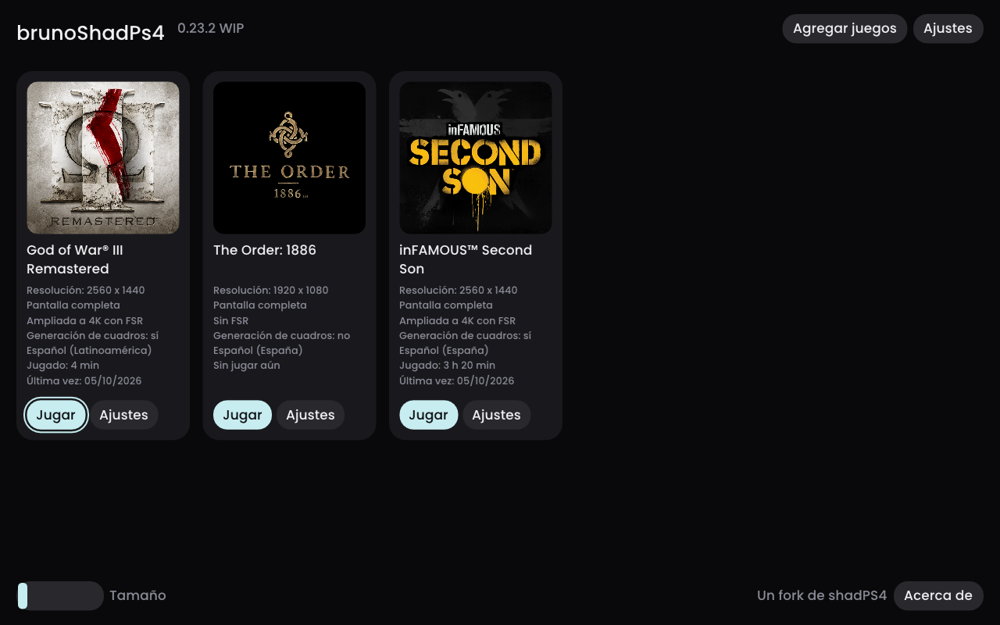

* **Generación de cuadros (AMD FSR 3)** integrada en el emulador, con los fps reales y los generados en el indicador.
* **Shaders en segundos**: los shaders guardados se compilan al iniciar en todos los núcleos del procesador (en God of War III, de unos 55 s a menos de 6 s).
* **Ajustes por juego**, con ajustes recomendados para los juegos probados y la resolución de render a elegir.

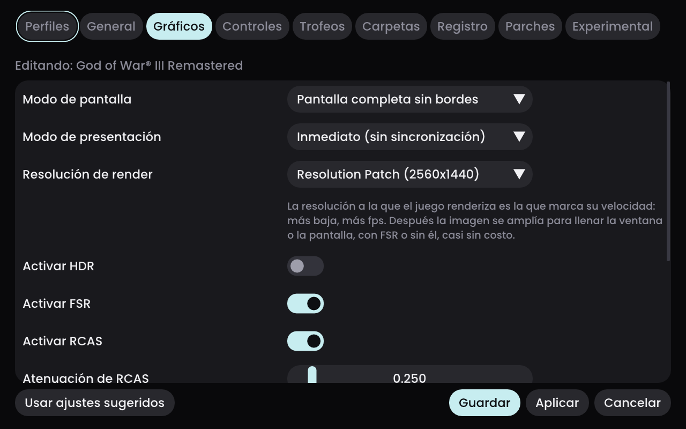

* **Gestor de parches**: muestra los parches instalados de cada juego, permite activarlos o apagarlos y agregar un archivo de parches.

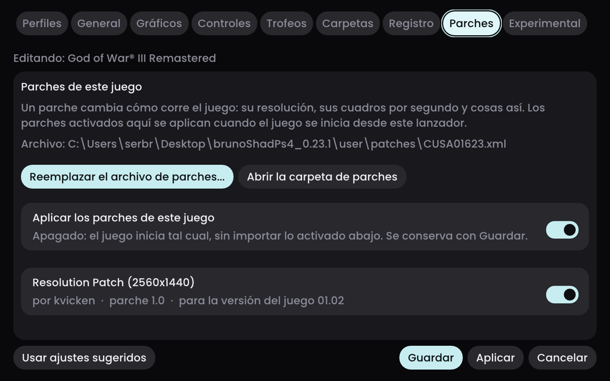

* **Perfiles**: unos ajustes globales y, encima, los propios de cada juego.

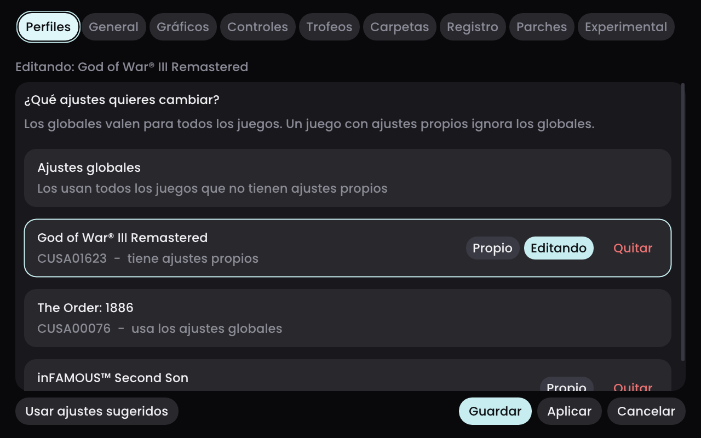

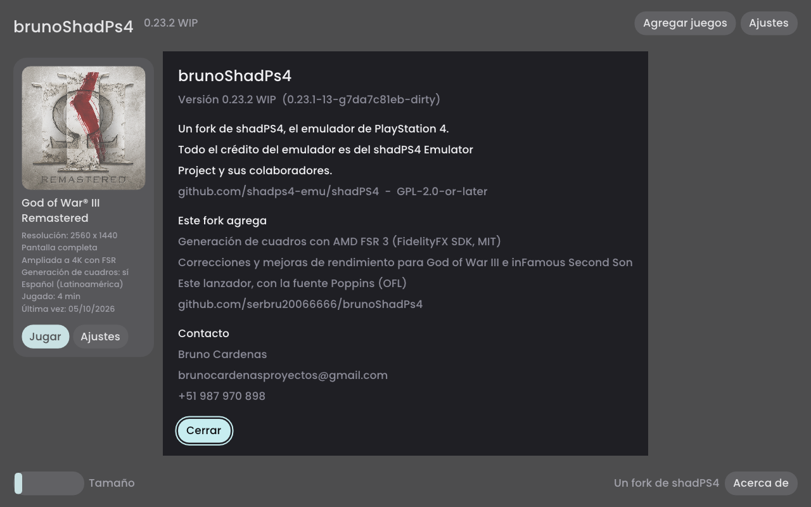

Las versiones compiladas están en [Releases](https://github.com/serbru20066666/brunoShadPs4/releases). El fork se desarrolla y se prueba en **Windows**, y sus versiones compiladas son solo para Windows.

> [!IMPORTANT]
> Este repositorio contiene principalmente el núcleo del emulador (core). Para compilarlo, es posible que necesites las dependencias de Vulkan y SDL3 configuradas adecuadamente en tu entorno.

# Estado
El emulador (y este fork) sigue en etapa de desarrollo activo.

# Licencia
El código original de este proyecto y sus modificaciones están bajo licencia de código abierto de acuerdo al proyecto original.
